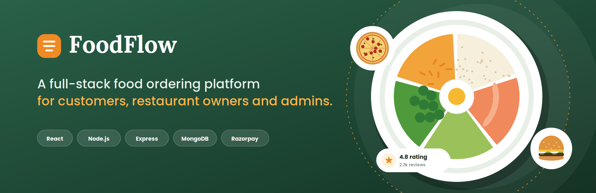
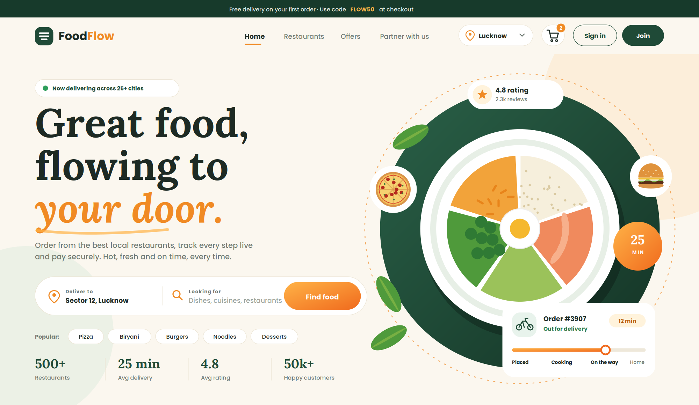
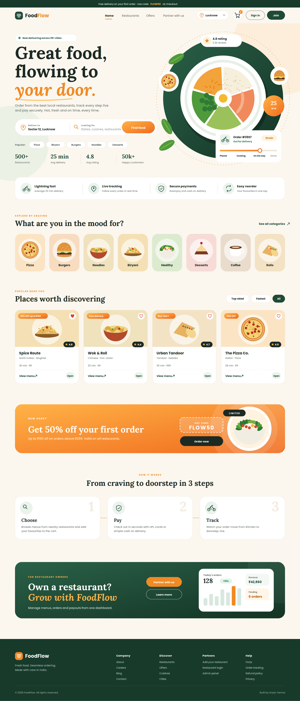
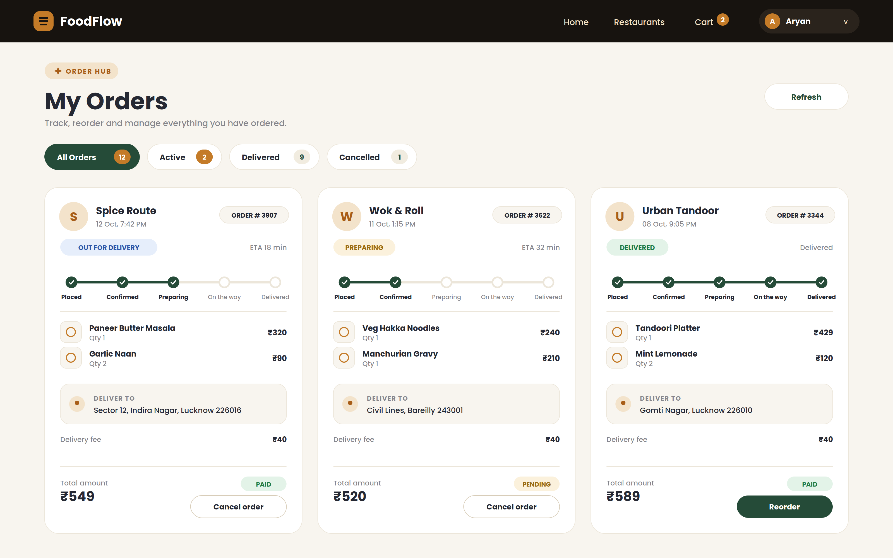
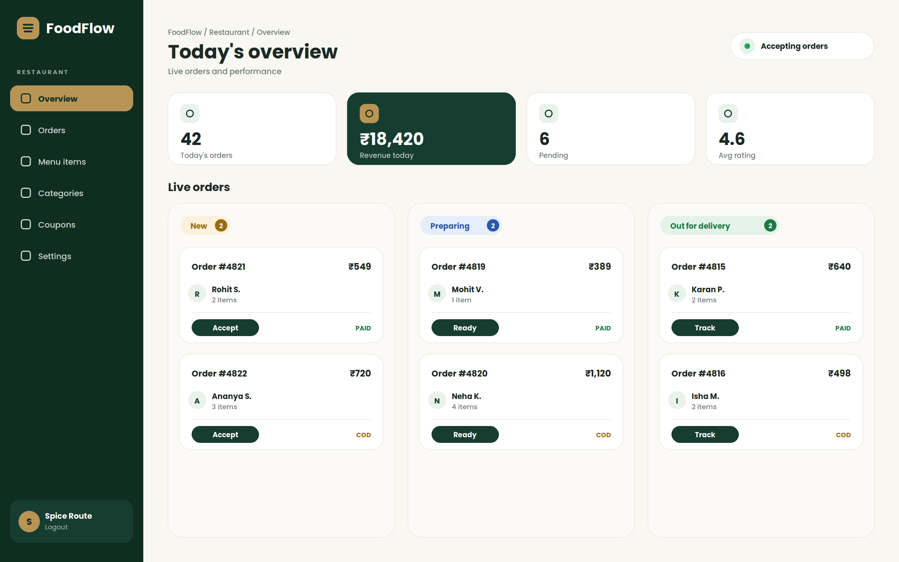
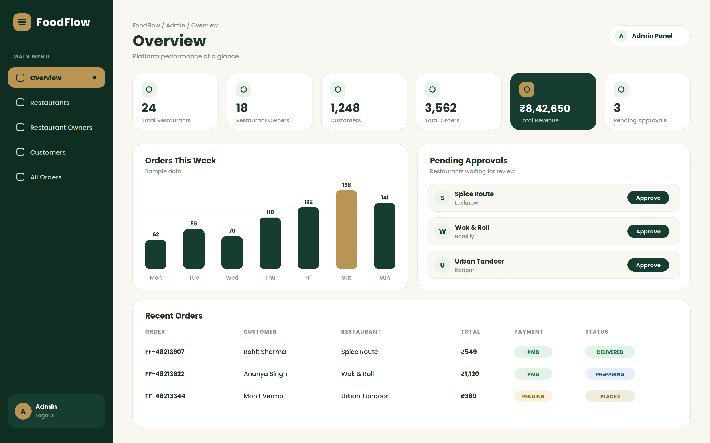
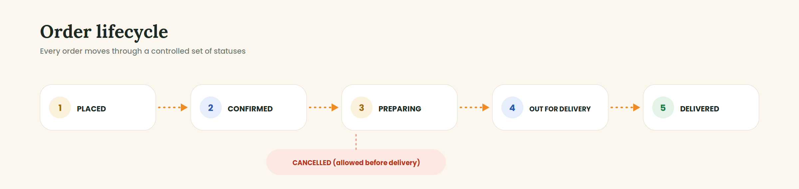
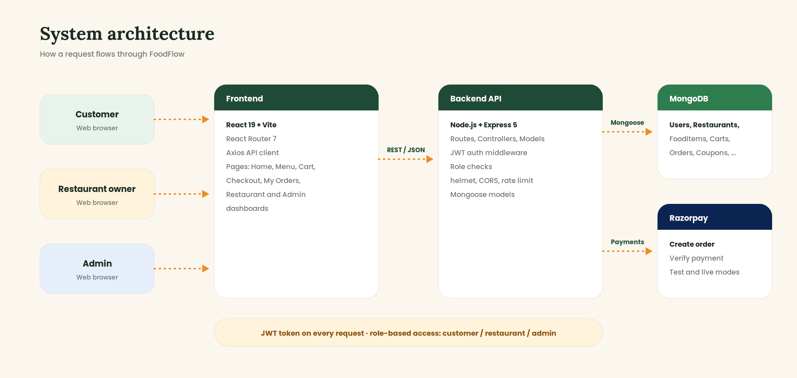

<div align="center">



<br />

# 🍽️ FoodFlow

### Fresh Food. Seamless Ordering. Better Experiences.

**A Modern Food Ordering & Restaurant Management System**

A full-stack web application that brings restaurant discovery, food selection, cart management, online checkout and role-based dashboards together in one convenient experience.

<br />


<br />

[🚀 View Repository](https://github.com/Aryanverma234/FoodFlow) · [🐛 Report an Issue](https://github.com/Aryanverma234/FoodFlow/issues)

**Built with ❤️ by Aryan Verma**

</div>

---

# 📑 Table of Contents

* [About FoodFlow](#-about-foodflow)
* [UI Preview](#️-ui-preview)
* [Food Gallery](#-food-gallery)
* [Project Objectives](#-project-objectives)
* [Problem Statement](#-problem-statement)
* [Key Features](#-key-features)
* [How It Works](#-how-it-works)
* [Technology Stack](#️-technology-stack)
* [System Architecture](#️-system-architecture)
* [Project Structure](#-project-structure)
* [Prerequisites](#-prerequisites)
* [Installation and Setup](#-installation-and-setup)
* [Environment Variables](#-environment-variables)
* [Application Modules](#-application-modules)
* [API Reference](#-api-reference)
* [Payment Integration](#-razorpay-payment-integration)
* [Security](#️-security-considerations)
* [Testing Checklist](#-testing-checklist)
* [Troubleshooting](#-troubleshooting)
* [Future Enhancements](#-future-enhancements)
* [Learning Outcomes](#-learning-outcomes)
* [Contributing](#-contributing)
* [Author](#-author)
* [License](#-license)

---

# 📌 About FoodFlow

**FoodFlow** is a full-stack web development project focused on creating a modern online food ordering and restaurant management experience.

The application uses a React-based frontend and a Node.js/Express backend with MongoDB for storage. The project is organized into separate frontend and backend directories to make development and maintenance easier.

FoodFlow covers the complete online food ordering journey: discovering restaurants, viewing menus, selecting items, managing a cart, saving delivery addresses, applying coupons, paying online with Razorpay or with cash on delivery, and tracking orders. Restaurant owners and admins each get their own dashboard.

The overall goal is to develop a practical web application while learning how frontend interfaces, backend APIs, databases, authentication, and third-party services work together.

## 📋 Project Information

| Property            | Details                                                             |
| ------------------- | ------------------------------------------------------------------- |
| Project Name        | FoodFlow                                                            |
| Project Category    | Full-Stack Web Development                                          |
| Application Type    | Food Ordering Web Application                                       |
| User Roles          | Customer, Restaurant Owner, Admin                                   |
| Frontend            | React.js with Vite                                                  |
| Backend             | Node.js and Express.js                                              |
| Database            | MongoDB with Mongoose                                               |
| Authentication      | JWT with role-based access control                                  |
| Language            | JavaScript                                                          |
| Payment Integration | Razorpay and Cash on Delivery                                       |
| Repository          | [Aryanverma234/FoodFlow](https://github.com/Aryanverma234/FoodFlow) |
| Development Status  | In Development                                                      |

---

# 🖼️ UI Preview

A look at the main screens of FoodFlow.

### 🏠 Home Page



<details>
<summary><b>View the full home page</b></summary>
<br />

</details>

### 📦 Customer: My Orders



### 🍳 Restaurant Dashboard



### 🛡️ Admin Dashboard



<p align="center">
  <i>Screens are shown with sample data for illustration.</i>
</p>

---

# 🍕 Food Gallery

FoodFlow is inspired by the convenience and visual appeal of modern online food ordering platforms.

<table>
<tr>
<td width="50%">

<h3 align="center">🍕 Pizza & Italian Food</h3>
<p align="center">Explore delicious food options and restaurant menus.</p>
</td>
<td width="50%">

<h3 align="center">🍔 Burgers & Fast Food</h3>
<p align="center">A convenient food discovery experience.</p>
</td>
</tr>
<tr>
<td width="50%">

<h3 align="center">🥗 Fresh & Healthy</h3>
<p align="center">Browse different types of food in one place.</p>
</td>
<td width="50%">

<h3 align="center">🔥 Grilled Specialities</h3>
<p align="center">Discover more food inspiration.</p>
</td>
</tr>
</table>

<p align="center">
  <i>Food photographs are illustrative and do not necessarily represent live products available in the application.</i>
</p>

---

# 🎯 Project Objectives

FoodFlow aims to:

* Build a modern and user-friendly food ordering website.
* Develop reusable UI components using React.
* Implement frontend navigation and application state management.
* Organize backend routes, controllers and server-side logic.
* Understand frontend-to-backend API communication.
* Work with database connectivity and data modeling.
* Develop authentication and role-based authorization workflows.
* Implement shopping cart and checkout functionality.
* Integrate an online payment workflow.
* Apply environment-based configuration.
* Practice Git, GitHub, debugging, and technical documentation.
* Build a portfolio project demonstrating full-stack development concepts.

---

# ❓ Problem Statement

Traditional food ordering may involve contacting restaurants directly, checking menus manually, and communicating order details separately.

A web-based food ordering system can simplify this process by providing a centralized platform for discovering food, reviewing menus, managing selections, and proceeding to checkout.

FoodFlow explores this solution through an organized web interface and a modular application architecture.

## 💡 Proposed Solution

FoodFlow provides a workflow in which customers can:

1. Open the website.
2. Explore restaurants and food items.
3. View available menu information.
4. Select items and add them to a cart.
5. Review quantities and order totals.
6. Provide delivery information.
7. Apply a coupon and proceed to checkout.
8. Pay online with Razorpay or choose cash on delivery.
9. Track the order and view order history.

---

# ✨ Key Features

## 🖥️ 1. Modern User Interface

* Clean and organized website layout.
* Green and saffron visual identity.
* Consistent typography and spacing.
* Component-based interface design.
* Page-based navigation.
* Responsive design considerations.

## 🔐 2. User Authentication and Roles

* User registration and login.
* JWT-based authentication.
* Secure password hashing with bcrypt.
* Authentication state management with React Context.
* Role-based access control for customers, restaurant owners and admins.

## 🍽️ 3. Restaurant Discovery

* Restaurant listings.
* Restaurant information.
* Menu navigation.
* Category-based food discovery and search.

## 📖 4. Food Menu

* Food name, description, price and image.
* Restaurant association.
* Menu categories.
* Availability status.

## 🛒 5. Shopping Cart

* Adding items.
* Updating quantities.
* Removing items.
* Calculating subtotals.
* Reviewing the cart before checkout.

## 📍 6. Delivery Address

* Save and manage delivery addresses.
* Select an address at checkout.

## 💳 7. Checkout and Coupons

* Order review with totals.
* Coupon codes applied at checkout.
* Choice of Razorpay (online) or cash on delivery.

## 💰 8. Razorpay Integration

* Payment order creation on the backend using server-side credentials.
* Payment verification on the backend.
* Payment status tracking: `PENDING`, `PAID`, `FAILED`, `REFUNDED`.

## 📦 9. Order Management

* Order placement, history and status tracking.
* Order cancellation.
* Restaurant owners update order status through the lifecycle.
* Notifications for order updates.

## 🍳 10. Restaurant and Admin Dashboards

* **Restaurant dashboard:** profile, menu categories, food items, live orders and coupons.
* **Admin dashboard:** platform statistics, restaurant approvals, user and order management.

## ⭐ 11. Reviews and Favourites

* Ratings and reviews.
* Favourite restaurants and dishes.

## 🧩 12. Modular Architecture

* Separate frontend and backend applications.
* Organized React pages and contexts.
* Controller, route, model and middleware layers on the server.
* Environment-based configuration.
* Git-based version control.

---

# 🔄 How It Works

The customer journey:

```text
                ┌─────────────────────┐
                │    Open FoodFlow    │
                └──────────┬──────────┘
                           │
                           ▼
                ┌─────────────────────┐
                │  Explore Restaurants│
                │      and Food       │
                └──────────┬──────────┘
                           │
                           ▼
                ┌─────────────────────┐
                │   Select Food Items │
                └──────────┬──────────┘
                           │
                           ▼
                ┌─────────────────────┐
                │    Shopping Cart    │
                └──────────┬──────────┘
                           │
                           ▼
                ┌─────────────────────┐
                │  Delivery Address   │
                └──────────┬──────────┘
                           │
                           ▼
                ┌─────────────────────┐
                │ Checkout and Coupon │
                └──────────┬──────────┘
                           │
                           ▼
                ┌─────────────────────┐
                │ Razorpay or Cash on │
                │      Delivery       │
                └──────────┬──────────┘
                           │
                           ▼
                ┌─────────────────────┐
                │    Track Your Order │
                └─────────────────────┘
```

### 📦 Order Lifecycle



---

# 🛠️ Technology Stack

## Frontend

| Technology   | Purpose                              |
| ------------ | ------------------------------------ |
| React.js     | Interactive user interfaces          |
| Vite         | Development server and build tooling |
| JavaScript   | Application logic                    |
| HTML5        | Page structure                       |
| CSS3         | Styling and layouts                  |
| React Router | Client-side navigation               |
| Context API  | Shared authentication and cart state |
| Axios        | HTTP requests to the API             |

## Backend

| Technology         | Purpose                            |
| ------------------ | ---------------------------------- |
| Node.js            | JavaScript runtime                 |
| Express.js         | Backend framework                  |
| MongoDB            | NoSQL database                     |
| Mongoose           | MongoDB object modeling            |
| dotenv             | Environment-variable management    |
| bcryptjs           | Password hashing                   |
| jsonwebtoken       | JWT authentication                 |
| cookie-parser      | Cookie parsing                     |
| Helmet             | HTTP security headers              |
| Morgan             | Request logging                    |
| express-rate-limit | Request rate limiting              |
| CORS               | Cross-origin request configuration |

## Tools and Services

| Tool               | Purpose                 |
| ------------------ | ----------------------- |
| Razorpay           | Payment integration     |
| Git                | Version control         |
| GitHub             | Source-code hosting     |
| npm                | Package management      |
| ESLint             | Code linting            |
| Visual Studio Code | Development environment |
| Chrome DevTools    | Browser debugging       |

---

# 🏗️ System Architecture

FoodFlow follows a frontend-backend architecture.



### Architecture Explanation

1. **Frontend:** React pages and components display data and handle user interactions.
2. **API layer:** Axios sends REST requests with a JWT to the backend.
3. **Backend:** Express routes, authentication and role middleware, and controllers run the business logic.
4. **Database:** MongoDB stores users, restaurants, menus, carts, orders, coupons, reviews and more through Mongoose models.
5. **Payment service:** Razorpay processes online payments, and the backend verifies the result.

---

# 📂 Project Structure

```text
FoodFlow/
│
├── frontend/
│   ├── public/
│   ├── src/
│   │   ├── context/
│   │   │   ├── AuthContext.jsx
│   │   │   └── CartContext.jsx
│   │   │
│   │   ├── pages/
│   │   │   ├── Home.jsx
│   │   │   ├── Login.jsx
│   │   │   ├── Register.jsx
│   │   │   ├── Restaurants.jsx
│   │   │   ├── Menu.jsx
│   │   │   ├── Cart.jsx
│   │   │   ├── Address.jsx
│   │   │   ├── Checkout.jsx
│   │   │   ├── OrderSuccess.jsx
│   │   │   ├── MyOrders.jsx
│   │   │   ├── Settings.jsx
│   │   │   ├── RestaurantDashboard.jsx
│   │   │   └── AdminDashboard.jsx
│   │   │
│   │   ├── App.jsx
│   │   ├── Footer.jsx
│   │   └── main.jsx
│   │
│   └── package.json
│
├── backend/
│   ├── src/
│   │   ├── config/          # Database connection
│   │   ├── controllers/     # Request handlers
│   │   ├── middlewares/     # Authentication and role checks
│   │   ├── models/          # Mongoose schemas
│   │   ├── routes/          # API route definitions
│   │   ├── services/        # Shared business logic
│   │   ├── app.js
│   │   └── server.js
│   │
│   └── package.json
│
├── docs/                    # README images
├── .gitignore
└── README.md
```

---

# 💻 Prerequisites

Install the following tools before running the application.

### 1. Node.js and npm

Check the installation:

```bash
node -v
npm -v
```

Download: [Node.js](https://nodejs.org/)

### 2. Git

Check the installation:

```bash
git --version
```

Download: [Git](https://git-scm.com/)

### 3. MongoDB

Use a local MongoDB server or a MongoDB Atlas database.

* [MongoDB](https://www.mongodb.com/)
* [MongoDB Atlas](https://www.mongodb.com/products/platform/atlas)

> Order placement uses MongoDB transactions, which need a **replica set**. MongoDB Atlas provides this by default.

### 4. Code Editor

Visual Studio Code is recommended.

Download: [Visual Studio Code](https://code.visualstudio.com/)

---

# 🚀 Installation and Setup

## Step 1: Clone the Repository

```bash
git clone https://github.com/Aryanverma234/FoodFlow.git
```

Move into the project directory:

```bash
cd FoodFlow
```

## Step 2: Install Backend Dependencies

```bash
cd backend
npm install
```

## Step 3: Configure the Backend

Create a `.env` file inside the `backend` folder. See the next section for the full template.

## Step 4: Start the Backend

```bash
npm run dev
```

Or run it without auto-reload:

```bash
npm start
```

## Step 5: Install and Start the Frontend

Open another terminal:

```bash
cd frontend
npm install
npm run dev
```

Vite displays the local development address, usually:

**http://localhost:5173/**

Open the address in your browser.

---

# 🔐 Environment Variables

Environment variables keep application configuration separate from the source code.

## Backend `.env`

Create `backend/.env`:

```env
PORT=5000

MONGODB_URI=mongodb://127.0.0.1:27017/foodflow

JWT_SECRET=replace_with_a_long_random_secret

JWT_EXPIRES_IN=7d

RAZORPAY_KEY_ID=your_razorpay_test_key_id

RAZORPAY_KEY_SECRET=your_razorpay_test_key_secret
```

## Frontend Configuration

The frontend currently calls the API at `http://localhost:5000/api`, and the backend allows requests from `http://localhost:5173` (set in `backend/src/app.js`). Update both when you deploy the app to another host.

### Security Rules

* Never commit real `.env` files.
* Never publish database passwords.
* Never expose payment secret keys in frontend code.
* Use placeholder values in example environment files.
* Keep `.gitignore` configured appropriately.

---

# 🧩 Application Modules

| Module              | Responsibility                                      |
| ------------------- | --------------------------------------------------- |
| Home                | Main landing page                                   |
| Login / Register    | User authentication                                 |
| Restaurants         | Restaurant discovery                                |
| Menu                | Food item presentation                              |
| Cart                | Selected items and quantities                       |
| Address             | Delivery information                                |
| Checkout            | Order review, coupons and payment                   |
| Order Success       | Order confirmation                                  |
| My Orders           | Order history, tracking and cancellation            |
| Settings            | Account settings                                    |
| Restaurant Dashboard| Menu, orders and coupons for restaurant owners      |
| Admin Dashboard     | Platform statistics and management                  |
| Auth Context        | Shared authentication state                         |
| Cart Context        | Shared cart state                                   |

---

# 📡 API Reference

All routes are prefixed with `/api`.

| Route             | Purpose                                  |
| ----------------- | ---------------------------------------- |
| `/auth`           | Registration and login                   |
| `/users`          | Profile and account settings             |
| `/restaurants`    | Restaurant listing and management        |
| `/categories`     | Menu categories                          |
| `/food-items`     | Dishes                                   |
| `/cart`           | Cart operations                          |
| `/addresses`      | Saved delivery addresses                 |
| `/orders`         | Place, track, update and cancel orders   |
| `/coupons`        | Coupon management and validation         |
| `/reviews`        | Ratings and reviews                      |
| `/favorites`      | Favourite restaurants and dishes         |
| `/notifications`  | In-app notifications                     |
| `/payments`       | Razorpay order creation and verification |
| `/admin`          | Admin statistics and management          |

---

# 💳 Razorpay Payment Integration

FoodFlow supports online payments through Razorpay, along with cash on delivery.

The payment workflow:

1. The user proceeds from the cart to checkout.
2. The backend creates a payment order using server-side credentials.
3. The frontend opens the payment interface.
4. The user completes or cancels the payment.
5. The backend verifies the payment result.
6. The application records the order and payment status.

### Payment Security

A reliable implementation should:

* Use test credentials during development.
* Keep secret keys on the backend.
* Verify payment signatures server-side.
* Handle failed and cancelled payments.
* Prevent duplicate order processing.
* Avoid trusting frontend success messages alone.
* Keep payment and order statuses consistent.

Official documentation: [Razorpay Docs](https://razorpay.com/docs/)

---

# 🛡️ Security Considerations

### Authentication

* Passwords are hashed with bcrypt.
* Tokens are verified on the backend.
* Routes are protected by authentication and role middleware.

### API Security

* `helmet` sets security-related HTTP headers.
* CORS is restricted to the frontend origin.
* `express-rate-limit` limits repeated requests.
* Errors should not expose sensitive details.

### Database Security

* Protect database credentials.
* Restrict database access.
* Validate incoming data.

### Production Deployment

* Use HTTPS.
* Store secrets securely.
* Update dependencies.
* Configure production environment variables.
* Test payment verification before accepting real payments.

---

# 🧪 Testing Checklist

Use this checklist to verify the application before a demonstration or deployment.

### Frontend

* [ ] Home page loads successfully.
* [ ] Navigation works correctly.
* [ ] Login and registration work.
* [ ] Restaurant and menu pages display expected information.
* [ ] Cart operations work correctly.
* [ ] Address and checkout pages load.
* [ ] Error states are handled appropriately.
* [ ] Layout works on different screen sizes.

### Backend

* [ ] Server starts successfully.
* [ ] Environment variables are configured.
* [ ] Database connection works.
* [ ] API endpoints return expected responses.
* [ ] Invalid requests are handled safely.
* [ ] Authentication and role checks work correctly.
* [ ] Errors do not expose sensitive information.

### Payments

* [ ] Test credentials are configured.
* [ ] Successful payment flow is tested.
* [ ] Failed and cancelled payments are handled.
* [ ] Server-side verification works.
* [ ] Duplicate processing is handled appropriately.

### Repository

* [ ] README commands match the actual scripts.
* [ ] No secrets are committed.
* [ ] Required dependencies are declared.
* [ ] Project setup works on a fresh environment.

---

# 🔧 Troubleshooting

## `npm` Is Not Recognized

Check the Node.js installation:

```bash
node -v
npm -v
```

If the commands fail, install or repair Node.js and reopen the terminal.

## `Cannot Find Module`

Run this command from the directory containing the relevant `package.json`:

```bash
npm install
```

## Frontend Cannot Connect to Backend

Check:

* Is the backend running on port 5000?
* Does the frontend call `http://localhost:5000/api`?
* Is CORS allowing `http://localhost:5173`?
* Are required environment variables present?

Inspect the browser console and Network tab for errors.

## MongoDB Connection Error

Verify the `MONGODB_URI`, database credentials, network permissions, and database availability.

## Transaction Error When Placing an Order

Order placement uses MongoDB transactions. Run MongoDB as a replica set, or use MongoDB Atlas.

## Payment Does Not Complete

Check the test credentials, payment-order creation, API responses, and backend payment verification. Never expose secret keys while debugging.

## Blank Frontend Page

Open browser developer tools and inspect the console for JavaScript errors, incorrect imports, and route configuration problems.

## Port Already in Use

Stop the process using the requested port or configure an available alternative.

---

# 🔮 Future Enhancements

## Deployment and Configuration

* Deploy the frontend and backend with MongoDB Atlas.
* Move the API base URL and CORS origin into environment variables.
* Continuous integration and deployment.

## Quality and Reliability

* Automated unit and integration tests.
* Server-side request validation.
* Centralized error handling.
* API documentation with Swagger or Postman.

## Features

* Refund handling for cancelled paid orders.
* Real-time order updates with WebSockets.
* Pagination for order lists and admin tables.
* Sales reports and analytics.
* Improved mobile experience.

## Technical Improvements

* Image optimization.
* Accessibility improvements.
* Production monitoring.

---

# 📚 Learning Outcomes

Developing FoodFlow provides practical exposure to:

* React component-based development.
* Frontend routing and shared state.
* JavaScript application logic.
* REST API design.
* Node.js and Express.
* MongoDB, Mongoose and transactions.
* Authentication and role-based authorization.
* Environment-based configuration.
* Third-party payment integration.
* Debugging and error handling.
* Git and GitHub.
* Full-stack application architecture.
* Technical documentation.

---

# 🤝 Contributing

Suggestions and contributions are welcome.

1. Fork the repository.
2. Create a feature branch.
3. Implement your changes.
4. Test the affected functionality.
5. Commit your changes.
6. Open a pull request with a clear description.

Example commands:

```bash
git checkout -b feature/your-feature-name

git add .

git commit -m "Add your feature description"

git push origin feature/your-feature-name
```

Please avoid committing credentials, private configuration files, or unrelated changes.

---

# 👨‍💻 Author

<div align="center">

## Aryan Verma

**BCA Student | Full-Stack Web Developer**

Interested in building practical web applications and exploring modern software development technologies.

<br />

[](https://github.com/Aryanverma234)
[](https://linkedin.com/in/aryan-verma277)

</div>

---

# 📄 License

A license has not yet been specified in this README.

Before allowing others to reuse or distribute the project, choose an appropriate license and add a corresponding `LICENSE` file to the repository. Until then, do not assume that the project is available under a particular open-source license.

---

<div align="center">


<br />

### ❤️ Made with passion for food and technology.

**FoodFlow — Bringing food ordering and technology together.**

⭐ If you find this project interesting, explore the repository and share your feedback.

</div>
